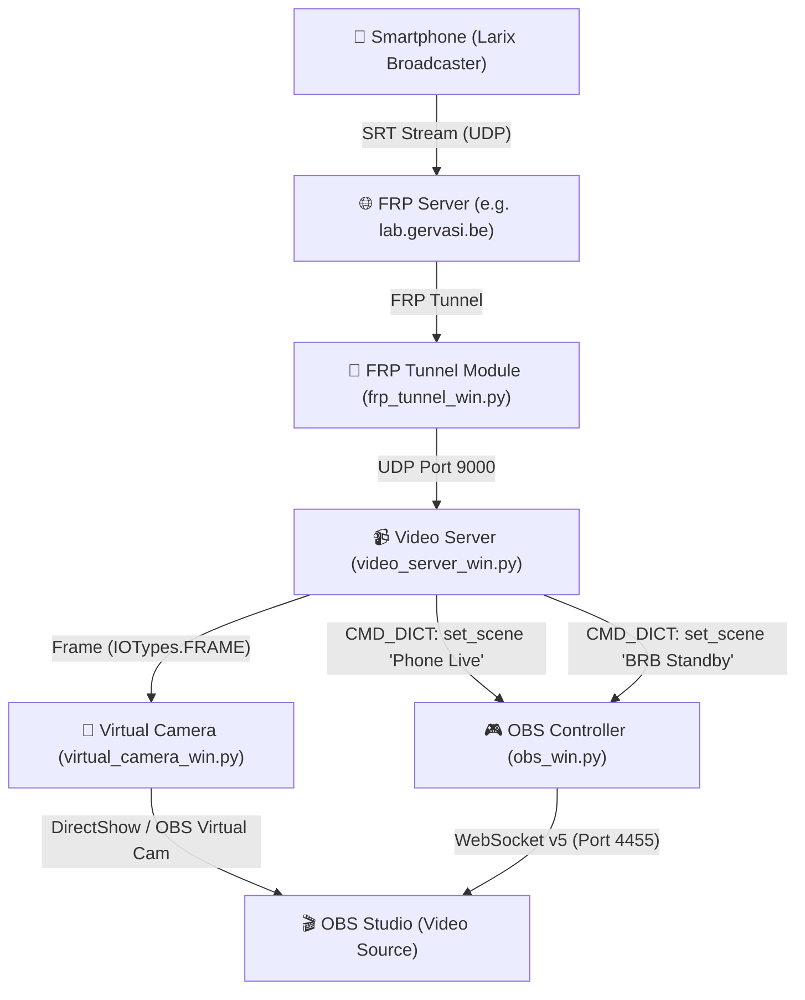

# Video Server Module (`video_server_win.py`)

## 1. Description & Capabilities

The **Video Server** module provides a real-time video stream ingestion server and stream health watchdog for Pipeline Creator. It accepts incoming live video streams over various modern protocols (SRT, RTMP, RTSP, UDP, HTTP) and integrates with **OBS Studio**, **Virtual Camera**, and **FRP Tunnel**.

### Key Features
- **Multi-Protocol Support**:
  - **SRT Listener** (`srt://0.0.0.0:port?mode=listener&latency=...`): Ultra-low latency, packet loss recovery (ideal for mobile broadcasting with Larix Broadcaster).
  - **RTMP Listener / Server** (`rtmp://0.0.0.0:port/live/stream?listen=1`).
  - **RTSP / UDP / HTTP / Custom URLs**.
- **Multi-Backend Decoding**:
  - **VidGear (`CamGear`)**: Multi-threaded queueing and hardware-accelerated decoding.
  - **OpenCV (`cv2.VideoCapture`)**: Built-in FFmpeg backend.
  - **FFmpeg Direct Pipe**: Raw BGR24 frame reading.
- **Connection & Disconnection Watchdog**:
  - Instant detection when a stream connects (`CONNECTED`).
  - Automatic timeout detection (`DISCONNECTED`) when frames stop arriving for > $X$ seconds (e.g. 2.5s) when cell reception drops or broadcast ends.
  - Continuous re-listening loop for seamless auto-reconnect.
- **OBS Studio Automation (`CMD_DICT`)**:
  - Automatically switches OBS scenes when stream connects (e.g., switches to "Phone Live").
  - Automatically switches OBS scenes when stream disconnects or times out (e.g., switches to "Standby / BRB").
  - Emits custom JSON command dictionaries to `obs_win.py`.
- **Pipeline Frame Passthrough (`IOTypes.FRAME`)**:
  - Emits standard BGR frames `(np.ndarray, "stream_name")` to modules such as `virtual_camera_win.py`, object detectors, or image viewers.
- **FRP Tunnel Helper**:
  - Directly displays and sends matching FRP proxy configuration (UDP for SRT, TCP for RTMP) to `frp_tunnel_win.py`.

---

## 2. End-to-End Architecture

---

## 3. Step-by-Step Setup Guide

### Step 1: Configure FRP Tunnel (`frp_tunnel_win.py`)
1. Add an **FRP Tunnel** module to your pipeline.
2. In the FRP Tunnel settings:
   - **Proxy Type**: `udp` (for SRT) or `tcp` (for RTMP).
   - **Local IP**: `127.0.0.1`
   - **Local Port**: `9000`
   - **Remote Port**: `9000`
3. Click **Start Tunnel**.

### Step 2: Configure Video Server (`video_server_win.py`)
1. Add a **Video Server** module.
2. Settings:
   - **Protocol**: `SRT Listener`
   - **Host / Bind IP**: `0.0.0.0`
   - **Port**: `9000`
   - **SRT Latency**: `200` ms
   - **Disconnect Timeout**: `2.5` s
3. Automation Settings:
   - **On Stream CONNECT**: `Switch Scene` -> Scene Name: `Phone Live`
   - **On Stream DISCONNECT**: `Switch Scene` -> Scene Name: `BRB Standby`
4. Click **Start Server**. The badge will display `LISTENING...`.

### Step 3: Configure Larix Broadcaster on Smartphone (iOS / Android)
1. Open **Larix Broadcaster** -> **Settings** -> **Connections** -> **New Connection**.
2. **Name**: `My Stream`
3. **URL**: `srt://lab.gervasi.be:9000` (or your server's domain/IP).
4. **Mode**: `Caller`
5. **Latency**: `200` ms
6. Save and tap the big Red Record button to start streaming.

### Step 4: Connect Pipeline Modules
- Connect **Video Server** `[Frame]` output -> **Virtual Camera** `[Frame]` input.
- Connect **Video Server** `[CMD Dict]` output -> **OBS Controller** input.

---

## 4. Pipeline I/O Specifications

### Accepted Inputs
| Input Type | Format / Payload | Description |
| :--- | :--- | :--- |
| `CMD_DICT` | `{"command": "start"}`, `{"command": "stop"}`, `{"command": "restart"}`, `{"port": 9000}` | Programmatic control of server state and port |
| `TRIGGER` | `"START"`, `"STOP"`, `"RESTART"` | Action triggers |
| `TEXT` | `"START"`, `"STOP"`, `"RESTART"` | String actions |

### Outputs
| Output Key | Type | Description |
| :--- | :--- | :--- |
| `Frame` | `IOTypes.FRAME` | Live decoded BGR video frame tuple: `(np.ndarray, "stream_name")` |
| `CMD Dict` | `IOTypes.CMD_DICT` | Automation commands sent to OBS Controller (`{"command": "set_scene", ...}`) |
| `Trigger` | `IOTypes.TRIGGER` | State events: `"STREAM_CONNECTED"`, `"STREAM_DISCONNECTED"` |
| `Status` | `IOTypes.STATUS_DICT` | Telemetry dictionary containing FPS, bitrate, resolution, uptime, and state |
| `Text` | `IOTypes.TEXT` | Status string or active scene name |
