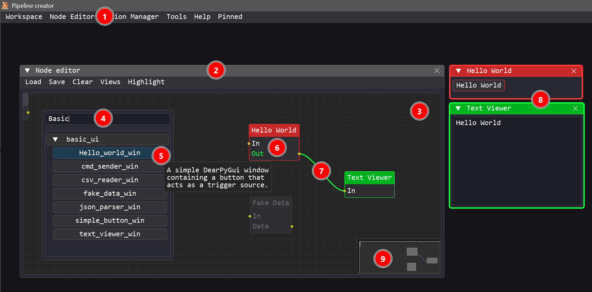
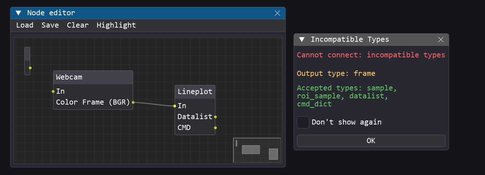
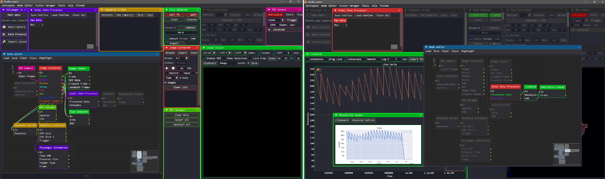
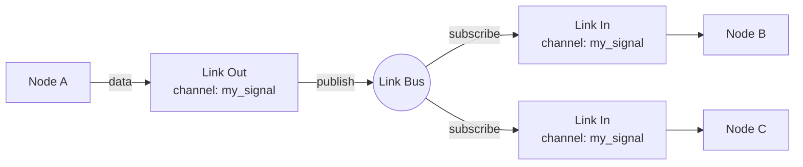
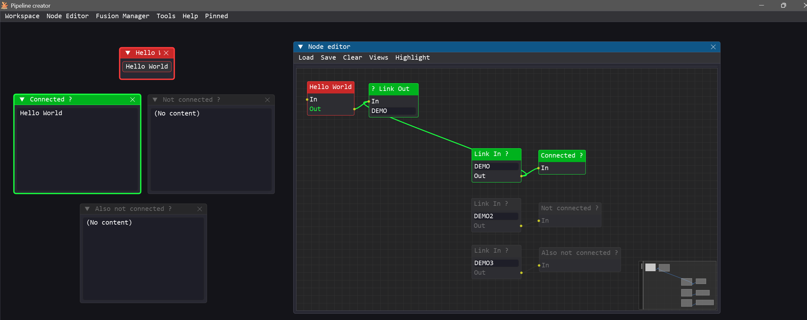
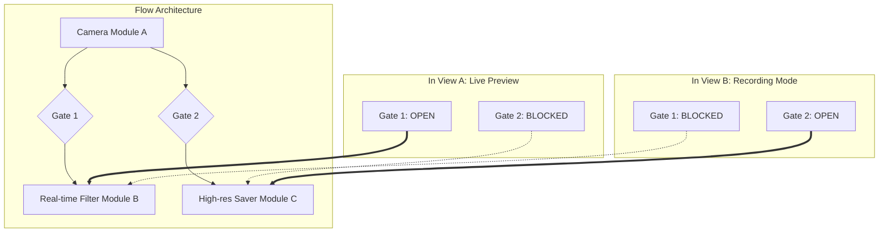
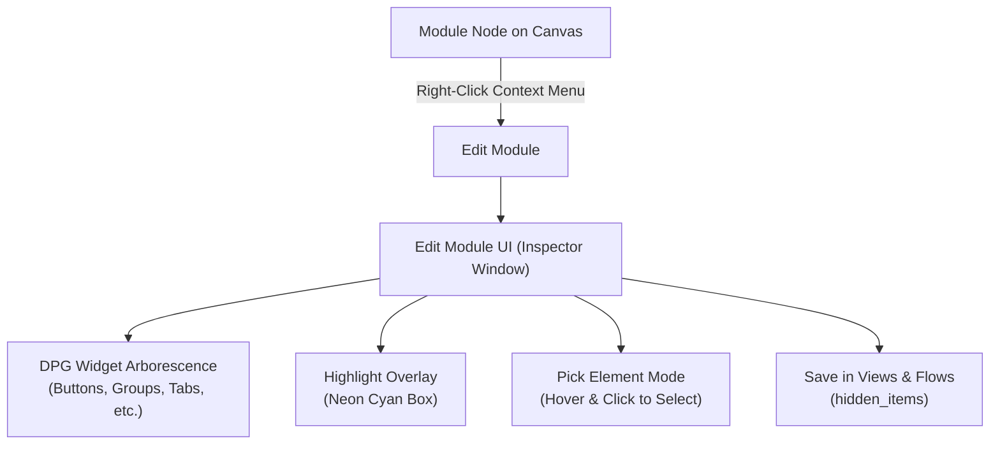

# <u>Node Editor Guide</u>

The **Node Editor** is the central workspace of Pipeline Creator. It is a visual canvas where you import, connect, and configure **node modules** to build custom pipelines. These pipelines can orchestrate control flows, process data, manage hardware interactions, or run visualization routines.

- **Module Connectivity**: Each module is equipped with a single input terminal and can have one or more output terminals.
- **Custom Logic**: Modules can contain arbitrary code and logic. They may include a graphical user interface (GUI) window, or run entirely in the background as invisible processing units.
- **Automated Data Transfer**: The link bus and wire routing system that handles data transfer between modules is completely automated by Pipeline Creator.
- **Interoperability & Future-Proofing**: To ensure modules remain compatible and interoperable, a standardized [Input/Output typing system](developer_guide.md#iotypes-reference) validates each connection.

---

## <u>Opening the Node Editor</u>



1. The editor can be launched from the **Main Window menu bar** via **Node Editor** (requires *Advanced* or *Dev* privilege mode).
2. The editor runs as a floating, resizable window within the viewport, allowing it to be moved, scaled, or docked.
3. An infinite, pannable, and zoomable workspace where node modules are instantiated, repositioned, and linked.
4. Right-clicking anywhere on the empty canvas opens the Module Search Popup. It allows you to search for specific modules and browse available categories (fuzzy matching supported).
5. Hovering over any module in the search list displays its custom documentation string as a tooltip.
6. Clicking a module from the search list instantiates the node, placing it on the canvas exactly at the current mouse pointer position.
7. Wires can be drawn between modules by clicking and dragging from an output terminal to an input terminal. Connections can be deleted/destroyed by holding `Ctrl` and clicking the wire (`Ctrl + Left Click`).
8. Once a module is instantiated, its corresponding control window appears. Double-clicking a module's node on the canvas brings its corresponding window to the foreground.
9. The minimap helps you navigate and orient yourself in large, complex flow graphs.

!!! note "Module Auto-Discovery & Validation"
    Modules are automatically detected, validated, and loaded at startup (see [Developer Best Practices](developer_guide.md#developer-best-practices)) from the `/modules` folder structure. Modules are grouped by **category** (their parent folder inside `/modules`)

| Action | How |
|---|---|
| **Pan** | Hold `Middle Mouse Button` and drag, or scroll while hovering |
| **Move node(s)** | Drag a selected node header |
| **Focus window** | Double-click a node to bring its corresponding module window to the foreground |
| **Context menu** | Right-click on a node to open actions: **Edit Module** (customize UI element visibility and layout), display module tutorial, rename the node, send to pinned modules, or delete the node/module. |

Every Input/Output has a declared **IOType** (e.g. `NUMBER`, `FRAME`, `TRIGGER`, `CMD_DICT`). When you attempt to connect incompatible types, the editor will show a **warning modal** explaining the mismatch. Compatible connections are accepted silently.



## <u>Highlighting & Dimming</u>

When you select a node, Pipeline Creator highlights its **downstream graph** to make the data flow visible.

The highlighting mode is configurable via **Node Editor → Highlight** menu:
| Mode | Effect |
|---|---|
| **Show All** | Highlights the complete downstream chain |
| **Closest** | Highlights only directly connected nodes |
| **None** | Disables highlighting |




Nodes that have *no* connections are **dimmed** to indicate they are inactive.

---

## <u>Built-in Nodes: Link In / Link Out</u>

These special nodes allow you to route data between modules without drawing a physical wire. Instead of a wire, they transmit data by matching **channel names**. This is especially useful when the output of a single module needs to feed into multiple other modules, preventing the visual workspace from being cluttered with dozens of crisscrossing wires.

Set the exact same **channel name** on a *Link Out* node and one or more *Link In* nodes to automatically link them.


Clicking on a **Link Out** node automatically draws and highlights temporary virtual links on the canvas, allowing you to easily trace the "wireless" connections to all subscribed **Link In** nodes.



!!! warning "No IOType Validation on Virtual Wires"
    Unlike standard node terminals, **Link In** and **Link Out** nodes do not perform compatibility checks on `IOTypes`. They use the generic `ANY` type, which theoretically allows connecting incompatible modules. 
    
    To avoid run-time errors, it is recommended to first prototype your flow using physical wires (which validates the data types), and then replace those wires with Link In/Out nodes to clean up the canvas.

---

## <u>Built-in Nodes: Gate (Conditional Flow Router)</u>

The **Gate** node is a built-in routing control node that acts as a switchable valve in your dataflow pipeline. It enables or stops data propagation along a connection branch without requiring you to delete or rewire connections.

```mermaid
graph LR
    A[Source Module] -->|In| G{Gate\nPass: ON/OFF}
    G -->|Out [Allowed]| B[Downstream Module B]
    G -->|Out [Allowed]| C[Downstream Module C]
```

### Key Behaviors & Rules

1. **Single-Input, Multi-Output Constraint**:
    - **Input terminal (`In`)**: Accepts **only 1 incoming connection**. If a connection is already made to `In`, subsequent connection attempts are rejected with an explicit alert. This guarantees that data streams never ambiguously collide inside a gate.
    - **Output terminal (`Out`)**: Supports **multiple outgoing connections** simultaneously (fan-out), enabling a single gate to route signals to several downstream modules.

2. **Dynamic IOType Deduction & Tooltip Annotations**:
    - The Gate node starts in generic mode (`IOTypes.ANY`).
    - The terminal names remain standard (`In` and `Out`), matching regular nodes. Hovering over `In` or `Out` displays a tooltip annotation showing the current `IOType` (e.g. `IOType: Frame`).
    - **Inferred from Input**: Connecting an upstream output to the Gate's `In` terminal automatically sets both the gate's input and output `IOType` to match the source type (e.g., `IOTypes.FRAME`). The tooltips on `In` and `Out` update immediately.
    - **Inferred from Output**: If you connect the Gate's `Out` terminal first to a downstream module expecting a specific type, the Gate automatically adapts its accepted input type to match that requirement.
    - **Automatic Reset**: When connections are removed, the Gate re-evaluates its type from remaining links. If all connections are removed, its tooltip safely resets to `IOType: Any`.

3. **Pass-Through State**:
    - **Interactive Checkbox (`Pass`)**: Toggle the pass-through state directly via the `Pass` checkbox on the node body or via `Right Click → Toggle Pass-through`.
    - **Dataflow**: When pass-through is active (`is_open=True`), calls to `input_cb` are forwarded to all connected downstream modules. When deactivated (`is_open=False`), incoming data is dropped.
    - **Highlighting Awareness (Wire Behavior)**:
        - In **Closest** mode, an open Gate behaves like a transparent **wire** rather than a terminating node: when it is highlighted, it forwards its color directly to the node(s) connected to its output without consuming the 1-hop depth limit.
        - When deactivated (`is_open=False`), the Gate stops highlight propagation, clearly indicating where dataflow is blocked.
        - In **Show All** mode, downstream graph propagation also flows through open gates and stops at closed gates.

---

## <u>Edit Module UI (Module Item Inspector)</u>

The **Module Item Inspector** allows you to inspect, customize, and declutter the user interface of any instantiated module window. You can hide unnecessary controls (buttons, inputs, plots, headers) to tailor the GUI specifically for your workflow.

### Opening the Inspector
Right-click any module node on the canvas and choose **Edit Module**. A dedicated inspector window opens for that specific module.

### Core Features

1. **Full UI Arborescence & Visibility Checkboxes**:
    - Displays the complete hierarchical tree of DearPyGui widgets belonging to the module window and its sub-windows.
    - Each element has an interactive **checkbox**:
        - **Checked**: Element is visible.
        - **Unchecked**: Element is hidden (`dpg.hide_item`).
    - The top toolbar includes a **Show All Elements** button to instantly restore full visibility, and a search filter bar to quickly locate items by tag or label.
    - **View Persistence**: Any customized element visibility state is automatically saved into View presets and restored upon loading.

2. **Precise Real-time Hover Highlighting**:
    - Hovering your mouse over any element row in the tree instantly draws a high-contrast bounding overlay around that widget on the live module window.
    - **Instant De-highlighting**: Highlighting is strictly active *only* while actively hovering the element row. The exact instant the cursor leaves the item row, the overlay is removed immediately.

3. **Interactive Pick Element Mode**:
    - Click **Pick Element** in the inspector toolbar.
    - Move your mouse over the actual module window. Each UI element beneath the mouse cursor is highlighted in real time.
    - **Click** on the target element:
        - The inspector automatically opens and expands all ancestor groups and tree nodes in the arborescence.
        - It scrolls directly to the exact line of that element.
        - The picked item is prominently flagged with a glowing **`★ PICKED`** badge button and bright cyan text.

---

### <u>Node Editor Menu Bar</u>

| Menu | Item | Description |
|---|---|---|
| **Load** | Flow… | Open a `.json` workspace file (replaces current graph) |
| **Load** | Reload Last Flow | Quickly reload the last opened file |
| **Load** | Subflow… | *Append* nodes from a file without clearing existing ones |
| **Load** | From Clipboard | Paste a JSON flow copied from another session |
| **Save** | Flow to File… | Export the entire workspace to a `.json` file |
| **Save** | Flow to Clipboard | Copy the serialized workspace to the clipboard |
| **Clear** | Clear All Nodes | Delete every node and link |
| **Clear** | Clear Selection | Delete only selected nodes |

### <u>Flow File Format</u>

Workspaces are stored as human-readable JSON:

```json
{
    "is_relative": true,
    "windows": [
        {
            "uuid": "41680190-3cb8-4a57-b08f-287df5d1bf2b",
            "module": "modules.basic_ui.csv_reader_win",
            "pos": [15.2, 20.4],
            "size": [30.5, 40.0],
            "visible": true,
            "params": {
                "default_path": "data/samples.csv"
            }
        }
    ],
    "connections": [
        {
            "from": "41680190-3cb8-4a57-b08f-287df5d1bf2b",
            "output": "CSV_DATA",
            "to": "50c3d9a4-2e91-4c17-910a-3cb7217fd8b2"
        }
    ],
    "link_nodes": [
        {
            "kind": "gate",
            "uuid": "7a8b9c0d-1234-5678-9abc-def012345678",
            "label": "Gate_Branch_B",
            "is_open": true,
            "io_type": "FRAME",
            "node_pos": [250, 180],
            "connections": {
                "Out": ["target-module-uuid"]
            },
            "incoming": {
                "source_uuid": "source-module-uuid",
                "output_key": "Frame"
            }
        }
    ]
}
```

| Field | Description |
|---|---|
| `is_relative` | If `true`, `pos`/`size` are screen percentages (portable across resolutions) |
| `uuid` | Unique identifier for the node instance |
| `module` | Python import path of the module class |
| `params` | Saved values from the module's `persistent_fields` list |
| `connections` | Wires between output terminals and destination nodes |
| `link_nodes` | Built-in Link In, Link Out, and Gate nodes (including their pass-through states and channels) |

---

## <u>Views & Dynamic Flow Routing</u>

**Views** are named presets that save both **window layouts** (position, size, visibility of each module window) and **Gate pass-through states** (`is_open`).

### Dynamic Flow Routing via Views

Because Views store Gate states, you can dynamically alter the active routing of your pipeline simply by switching Views!



- **Export View**: Save current window layout and live Gate states into a named preset via `Main Window → Views → Export View…` or from the **Pipeline Editor**.
- **Apply View**: Switching views via the **Views** menu or programmatically via `apply_named_view("ViewName")` applies window positioning and toggles all Gates to their saved state.
- **Pipeline Editor**: Under the **Views** tab, expand the **Gates in this View** section to individually toggle which gates are pass-through for the selected view.

---

## <u>Edit Module UI & Item Inspector</u>

Each module instantiated in Pipeline Creator comes with an intuitive **Item Inspector** (similar to Dear PyGui's built-in item registry) designed to customize the visibility of its interface elements.



### Accessing the Inspector
1. In the **Node Editor**, right-click any module node.
2. In the context popup menu, click **Edit Module**.
3. The **Edit Module UI** window opens for that specific module.

### Inspector Capabilities
- **Hierarchical Widget Tree**: Displays the full tree of Dear PyGui items belonging to the module (including sub-windows and container slots), annotated with widget types (`[Button]`, `[ChildWindow]`, `[Group]`, `[InputText]`, etc.), labels, and aliases.
- **Visibility Checkboxes**: Check or uncheck the box next to any widget to instantly show or hide it in the module's window (checked = visible, unchecked = hidden).
- **Automatic Hover Highlighting**: Simply hover your mouse over any element in the inspector list to immediately draw a glowing neon cyan overlay rectangle around that widget on screen. Moving the mouse off the list clears the highlight automatically.
- **Interactive Pick Element Mode**:
    1. Click the **Pick Element** button in the inspector toolbar.
    2. Move your cursor over the module's window—the inspector will dynamically track and draw an overlay bounding box around whichever widget is directly under the mouse.
    3. Left-click the desired widget: the inspector automatically expands all parent nodes to reveal the element, scrolls directly to its line in the tree, highlights it in cyan (`>> [Type] Label`), and cancels pick mode without hiding or filtering the rest of the tree.
- **Show All Elements**: Click **Show All Elements** in the toolbar to restore visibility to all elements across the module.
- **Search / Filter**: Type in the search bar to filter elements by widget type, label, tag, or item ID.

### View & Flow Persistence
Any customization made to a module's element visibility is automatically persisted:
- **Views**: When exporting a View (`Views → Export View…`), the list of hidden elements (`hidden_items`) is saved per window. Switching views seamlessly restores each module's element visibility state.
- **Flow Files**: When saving a flow workspace (`.json`), `hidden_items` is saved into the window configuration, ensuring custom layouts and simplified interfaces are restored upon opening the flow.

