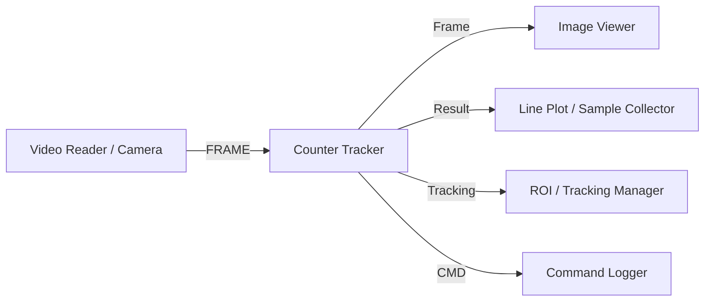

# Counter Tracker Module (`counter_tracker_win.py`)

## Description
The **Counter Tracker** (*Motilitometer Tracker*) module is the central analysis and processing engine of the Motilitometer suite. It integrates within a unified, multithreaded architecture:
1. Spatial preprocessing and geometric cropping (*circular or rectangular masks*).
2. Contour extraction and morphological segmentation (*watershed splitting, area, and circularity filtering*).
3. Object tracking (*centroid association and trajectory history over time*).
4. Dense optical flow (*Farneback algorithm for global population motility estimation*).
5. Dynamic drift correction (*angular and vector compensation for hydrodynamics/fluid currents*).
6. Phototaxis indexing (*instantaneous Phototaxis Index / PI calculations relative to light stimulus directions*).
7. Multithreaded and multiprocess batch processing (*parallelized video processing for high-throughput experiments*).

---

## Inputs / Outputs

### Inputs
- **`IOTypes.FRAME`**: Continuous input video stream (live camera, video reader, synthetic frame generator).
- **`IOTypes.TRIGGER`**: Synchronization pulse or action trigger for resetting tracking states and initiating batch cycles.
- **`IOTypes.FILE_PATH`**: Path to a video file for direct or queued batch processing.

### Outputs
- **`Frame`** (`IOTypes.FRAME`): Processed and annotated video frame (trajectories, optical flow vectors, contours, bounding boxes).
- **`CMD`** (`IOTypes.CMD_DICT`): Command telemetry, status reports, and execution timestamps.
- **`Tracking`** (`IOTypes.TRACKING`): Raw centroid tracking records and persistent object identifiers.
- **`Contours`** (`IOTypes.CONTOURS`): List of segmented object contour coordinates.
- **`Result`** (`IOTypes.SAMPLE`): Combined composite sample of real-time computed metrics.
- **`Count`** (`IOTypes.SAMPLE`): Number of detected organisms per frame.
- **`Motility`** (`IOTypes.SAMPLE`): Mean speed or aggregate optical flow motility intensity.
- **`Phototaxis`** (`IOTypes.SAMPLE`): Instantaneous Phototaxis Index (-1.0 to +1.0).
- **`Raw Speeds`** (`IOTypes.SAMPLE`): Individual instantaneous speed distributions.
- **`Vectors`** (`IOTypes.VECTORS`): Vector field of mean trajectory displacements or optical flow.
- **`Trigger`** (`IOTypes.TRIGGER`): Completion impulses emitted upon sequence completion or alert triggers.

---

## Parameters and Configuration (Persistent Fields)

| Parameter | Type | Default Value | Description |
| :--- | :--- | :--- | :--- |
| **`label`** | `str` | `"Motilitometer Tracker"` | Window header title. |
| **`x_axis_mode`** | `str` | `"Fixed ΔT"` | Temporal axis mode (`"Fixed ΔT"` or frame synchronization). |
| **`delta_t`** | `float` | `0.0333` | Time interval $\Delta t$ between successive frames (seconds). |
| **`auto_export_csv`** | `bool` | `True` | Automatically export summary `.csv` files upon completion. |
| **`auto_export_raw`** | `bool` | `False` | Export raw trajectory vectors and matrices into compressed `.npz` files. |
| **`calibration`** | `float` | `0.7575` | Spatial scaling factor ($\mu m/\text{pixel}$ or $\text{mm}/\text{pixel}$). |
| **`fps`** | `float` | `30.0` | Camera acquisition frame rate (frames per second). |
| **`enable_preprocessing`** | `bool` | `True` | Enable morphological preprocessing pipeline (channel select, blur, inversion). |
| **`monochrome_mode`** | `str` | `"Grayscale"` | Color channel conversion mode (`"Grayscale"`, `"Red"`, `"Green"`, `"Blue"`, `"Cyan"`). |
| **`invert_image`** | `bool` | `False` | Invert image luminance (dark background vs. bright background). |
| **`prep_blur`** | `int` | `0` | Radius of initial Gaussian smoothing filter. |
| **`gamma`** | `float` | `1.0` | Non-linear gamma contrast adjustment exponent. |
| **`crop_type`** | `str` | `"None"` | Geometric mask type (`"None"`, `"Circular"`, `"Rectangular"`). |
| **`crop_radius`** | `int` | `150` | Circular mask radius in pixels. |
| **`crop_width`** | `int` | `300` | Rectangular mask width in pixels. |
| **`crop_height`** | `int` | `300` | Rectangular mask height in pixels. |
| **`show_crop_outline`** | `bool` | `True` | Display green outline overlay showing the active mask boundary. |
| **`remove_static`** | `bool` | `False` | Static background subtraction using reference frames $R_1 / R_2$. |
| **`similarity_threshold`** | `int` | `15` | Pixel similarity threshold for eliminating static background artifacts. |
| **`enable_focus_picking`** | `bool` | `False` | Enable local sharpness scoring (Tenengrad Sobel focus metric). |
| **`blob_alpha`** | `float` | `0.5` | Mask overlay transparency on the rendered output frame. |
| **`enable_watershed`** | `bool` | `False` | Enable watershed separation for touching/agglomerated objects. |
| **`enable_drift_correction`**| `bool` | `False` | Enable global hydrodynamic drift vector compensation. |
| **`drift_angle_tol`** | `float` | `15.0` | Angular tolerance for drift vector classification (degrees). |
| **`drift_mag_tol`** | `float` | `25.0` | Magnitude tolerance for drift vector classification. |
| **`emit_phototaxis_series`**| `bool` | `False` | Emit continuous phototaxis index series downstream. |
| **`pi_light_pos`** | `str` | `"Top (90°)"` | Angular orientation of stimulus light source. |
| **`pi_preset`** | `str` | `"Standard"` | Directional attraction quadrant preset. |

---

## Key Features

- **Dual Contour & Dense Flow Modes**: Seamlessly toggle between discrete individual tracking (contour segmentation, centroid assignment, trajectory histories) and continuous optical flow field analysis.
- **Real-Time Drift Compensation**: Isolates intrinsic active locomotion from passive hydrodynamic currents by estimating and subtracting the global drift vector.
- **Directional Analysis & Phototaxis Index**: Continuous real-time computation of directional preference and phototaxis index, optionally weighted by organism velocity.
- **Multiprocess Batch Processing**: Parallelized segment processing to rapidly analyze large multi-gigabyte video recordings.
- **Preset Management**: Dedicated import/export options for pipeline configurations stored in standard `.json` format.

---

## Pipeline Integration Example

