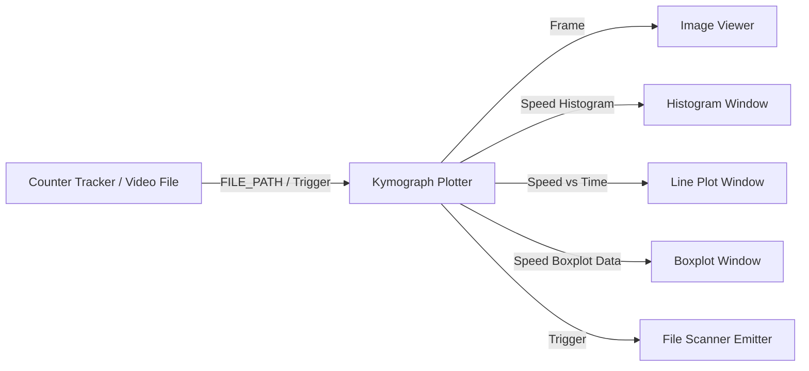

# Kymograph Plotter Module (`kymograph_plotter_win.py`)

## Description
The **Kymograph Plotter** module generates publication-quality spatio-temporal kymographs and motility distribution analytics from radial detection data (`.csv`) produced by the Motilitometer or automated worm/organism tracking pipelines.

Key capabilities include:
1. **2D Continuous Heatmaps**: Visualizes density variations over radial distance from a stimulus/pellet center versus elapsed time.
2. **3D Surface Elevation Meshes**: Reconstructs 3D topographical density landscapes with adjustable camera elevation and azimuth angles.
3. **Interactive 3D HTML Export**: Exports self-contained interactive 3D Plotly surfaces for web-based rotation, panning, and inspection.
4. **Sub-Population Segregation**: Simultaneously analyzes and displays:
   - **Total Population**
   - **Moving Organisms** ($\text{speed} \ge \text{static\_thresh}$)
   - **Static Organisms** ($\text{speed} < \text{static\_thresh}$)
5. **2D Gaussian Smoothing**: Independent spatio-temporal Gaussian filtering ($\sigma_{\text{time}}$ and $\sigma_{\text{space}}$) to highlight continuous population dynamics while suppressing single-frame tracking noise.
6. **Multi-Format Downstream Emission**: Emits rendered BGR image frames, speed histograms, mean speed kinetics over time, and boxplot distribution samples to connected analysis modules.

---

## Inputs / Outputs

### Inputs
- **`IOTypes.FILE_PATH`**: Direct path to a detection CSV file, or a video/directory path from which the associated `*_radial_detections.csv` or `*_radial.csv` file is automatically resolved.
- **`IOTypes.TRIGGER`**: Synchronization or re-run trigger (triggers processing on the current file or on an incoming path).

### Outputs
- **`Frame`** (`IOTypes.FRAME`): Rendered high-resolution composite BGR image frame (streamed to `Image_viewer_win` or `Video_viewer_win`).
- **`Speed Histogram`** (`IOTypes.SAMPLE`): Raw speed distribution array formatted for `Histogram_win`.
- **`Speed vs Time`** (`IOTypes.SAMPLE`): Mean speed kinetic series over elapsed time formatted for `Plot_win`.
- **`Speed Boxplot Data`** (`IOTypes.SAMPLE`): Time-binned speed distributions formatted for `Boxplot_win`.
- **`Trigger`** (`IOTypes.TRIGGER`): Completion signal carrying the path to the saved PNG or source CSV to orchestrate batch pipeline execution (`File_scanner_emitter_win`).

---

## Parameters and Configuration (Persistent Fields)

| Parameter | Type | Default Value | Description |
| :--- | :--- | :--- | :--- |
| **`label`** | `str` | `"Kymograph Plotter"` | Title displayed in the Dear PyGui window header. |
| **`csv_path`** | `str` | `""` | Absolute or relative file path to the source CSV detection file. |
| **`plot_title`** | `str` | `""` | Custom title displayed at the top of the plot (empty for none). |
| **`plot_mode`** | `str` | `"2D Continuous Heatmap"` | Plotting mode (`"2D Continuous Heatmap"` or `"3D Surface Elevation"`). |
| **`num_bins`** | `int` | `50` | Number of radial distance bins. |
| **`static_thresh`** | `float` | `0.5` | Speed cutoff threshold ($\mu m/s$ or $px/s$) separating moving from static organisms. |
| **`smooth_time`** | `float` | `3.0` | Standard deviation ($\sigma$) of the temporal Gaussian smoothing kernel. |
| **`smooth_space`** | `float` | `2.0` | Standard deviation ($\sigma$) of the spatial Gaussian smoothing kernel. |
| **`interpolation`** | `str` | `"bicubic"` | 2D image interpolation mode (`"bicubic"`, `"gaussian"`, `"bilinear"`, `"nearest"`, `"spline16"`). |
| **`plot_total`** | `bool` | `True` | Include total population panel in the output figure. |
| **`plot_moving`** | `bool` | `True` | Include moving population panel in the output figure. |
| **`plot_static`** | `bool` | `True` | Include static population panel in the output figure. |
| **`cmap_total`** | `str` | `"magma"` | Colormap used for the total population heatmap/surface. |
| **`cmap_moving`** | `str` | `"viridis"` | Colormap used for the moving population heatmap/surface. |
| **`cmap_static`** | `str` | `"cividis"` | Colormap used for the static population heatmap/surface. |
| **`same_scale`** | `bool` | `False` | Normalize colorbars and vertical z-limits across all active panels. |
| **`fps`** | `float` | `30.0` | Video acquisition frame rate used to convert frame indices to elapsed seconds. |
| **`n_time_steps_3d`** | `int` | `40` | Number of temporal sampling steps along the time axis in 3D surface mode. |
| **`camera_elev`** | `float` | `30.0` | Elevation angle for 3D camera viewing (degrees). |
| **`camera_azim`** | `float` | `-60.0` | Azimuth angle for 3D camera viewing (degrees). |
| **`export_html_3d`** | `bool` | `False` | Export a standalone interactive Plotly 3D HTML file alongside the CSV. |
| **`auto_save_png`** | `bool` | `True` | Automatically save the rendered figure as a high-resolution PNG file. |
| **`dpi`** | `int` | `200` | Resolution (dots per inch) for exported PNG figures. |

---

## Key Features

- **Automatic File Resolution**: Accepts input video paths (`.mp4`), processed flag files (`.processed`), or directories, and resolves the target `*_radial_detections.csv` or `*_radial.csv` automatically.
- **Multi-Panel Comparative Views**: Simultaneously displays synchronized sub-populations (Total, Moving, Static) with independent colormap palettes or unified scaling.
- **Asynchronous Multithreaded Execution**: Offloads heavy numerical parsing, Gaussian kernel convolutions, and Matplotlib/Plotly rendering to a dedicated background daemon thread (`_process_worker`), keeping the GUI responsive.
- **Headless Matplotlib to OpenCV Conversion**: Employs Matplotlib's `Agg` headless backend to render figures directly into memory buffers, converted to standard BGR numpy arrays without requiring native display windows.
- **Modular Pipeline Integration**: Seamlessly dispatches structured `IOTypes.SAMPLE` packets to downstream plotting modules and sends completion `TRIGGER` pulses for batch folder scanning workflows.

---

## Pipeline Integration Example

