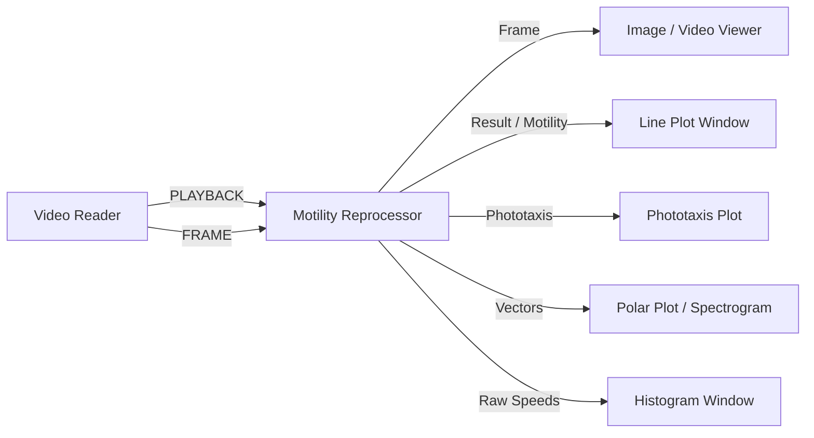

# Motility Reprocessor Module (`motility_reprocessor_win.py`)

## Description
The **Motility Reprocessor** replays previously processed Counter Tracker tracking data, kinetic metrics, motion vectors, and hydrodynamic drift measurements (`.npz` and `_drift.csv`) in frame-accurate synchronization with video playback.

When connected downstream of a `Video Reader` emitting `IOTypes.PLAYBACK`, this module monitors the active playback frame index and streams the corresponding historical time-series data to downstream visualization modules (Line Plots, Sample Containers, Polar Plots, Polar Spectrograms) exactly as if a live Counter Tracker were running in real time.

Additionally, the module provides a **Send All** feature to emit the entire video dataset at once, immediately populating downstream charts and spectrograms without requiring real-time video playback.

---

## Inputs / Outputs

### Inputs
- **`IOTypes.PLAYBACK`**: Playback state dictionary carrying `path`, `frame_idx`, `total_frames`, and stream `name`.
- **`IOTypes.FRAME`**: Optional raw video frame from `Video Reader` for overlaying population vectors and drift arrows.
- **`IOTypes.TRIGGER`**: Control triggers:
  - `"START"`: Clears downstream sample series and resets playback state.
  - `"SEND_ALL"`: Emits complete datasets for the entire video at once.
- **`IOTypes.CMD_DICT`**: Automation dictionary with action `"send_all"` to trigger bulk data emission programmatically.

### Outputs
- **`Frame`** (`IOTypes.FRAME`): Video frame rendered with population vector arrows, drift vector overlays, and optional simulated drifter particles.
- **`CMD`** (`IOTypes.CMD_DICT`): Playback telemetry, time codes, and status metadata.
- **`Result`** (`IOTypes.SAMPLE`): Metric sample series (Surface Coverage % or Mean Speed).
- **`Count`** (`IOTypes.SAMPLE`): Organism count time-series.
- **`Motility`** (`IOTypes.SAMPLE`): Active motility percentage time-series.
- **`Raw Speeds`** (`IOTypes.SAMPLE`): Speeds array reconstructed from stored 2D angular/speed histograms.
- **`Vectors`** (`IOTypes.VECTORS`): Global population motion vectors or batch vector payloads for Polar Plots and Polar Spectrograms.
- **`Phototaxis`** (`IOTypes.SAMPLE`): Instantaneous Phototaxis Index series $[-1, +1]$ relative to light stimulus directions.

---

## Parameters and Configuration (Persistent Fields)

| Parameter | Type | Default Value | Description |
| :--- | :--- | :--- | :--- |
| **`label`** | `str` | `"Motility Reprocessor"` | Header title for the module window. |
| **`active`** | `bool` | `True` | Master toggle to enable or suspend re-emission of metrics during playback. |
| **`view_mode`** | `str` | `"Combined"` | Replay view mode (`"Combined"`, `"Manip"`, `"Drift"`). |
| **`show_vector`** | `bool` | `True` | Draw the central yellow population vector arrow on output frames. |
| **`vector_scale`** | `float` | `1.0` | Scaling multiplier for drawn vector arrows ($0.1\times$ to $3.0\times$). |
| **`show_drift_vector`** | `bool` | `True` | Draw the magenta hydrodynamic drift vector arrow at the top of the frame. |
| **`show_fake_drifters`**| `bool` | `False` | Render animated passive particles flowing in the direction of measured drift. |
| **`emit_drift_series`** | `bool` | `True` | Emit drift speed and drift angle time-series to downstream plot modules. |
| **`x_axis_mode`** | `str` | `"Fixed ΔT"` | X-axis timestamping mode (`"Fixed ΔT"`, `"Timestamp"`, `"Index"`). |
| **`delta_t`** | `float` | `0.0333` | Frame time delta $\Delta t$ in seconds when using Fixed $\Delta T$ mode ($1 / \text{fps}$). |
| **`emit_phototaxis_series`** | `bool` | `False` | Emit Phototaxis Index time-series on `Result` and `Phototaxis` output ports. |
| **`pi_light_pos`** | `str` | `"Bottom (270°)"` | Angular position of the stimulus light source (`Bottom`, `Top`, `Right`, `Left`). |
| **`pi_preset`** | `str` | `"Standard (±45°)"` | Directional sector preset for attraction/repulsion quadrants. |
| **`pi_up_min`** | `float` | `180.0` | Lower bound (degrees) for the "Toward Light" angular quadrant. |
| **`pi_up_max`** | `float` | `360.0` | Upper bound (degrees) for the "Toward Light" angular quadrant. |
| **`pi_down_min`** | `float` | `0.0` | Lower bound (degrees) for the "Away from Light" angular quadrant. |
| **`pi_down_max`** | `float` | `180.0` | Upper bound (degrees) for the "Away from Light" angular quadrant. |
| **`pi_weight_speed`**| `bool` | `True` | Weight angles by vector velocity magnitude instead of unweighted counts. |

---

## Key Features

- **Synchronized Playback Simulation**: Emits historical data incrementally matching the video playback scrub head, allowing seamless review of tracking dynamics alongside footage.
- **Send All (Instant Batch Emission)**: Instantly dumps the entire video's time-series (Speed, Coverage, Count, Motility, Drift, Phototaxis) and vector history to downstream plots and polar spectrograms without waiting for video playback.
- **Dual-Source Data Merging**: Transparently reads both organism manipulation `.npz` files and hydrodynamic drift `_drift.csv` logs, providing a unified telemetry stream.
- **On-the-Fly Phototaxis Re-computation**: Allows researchers to reconfigure light source orientations, attraction angular sectors, and speed weighting post-acquisition without re-running the video tracking stage.
- **Visual Overlays**: Overlays global population vectors, drift vectors, and simulated passive drifter particles directly onto video frames before streaming to image and video viewers.

---

## Pipeline Integration Example

