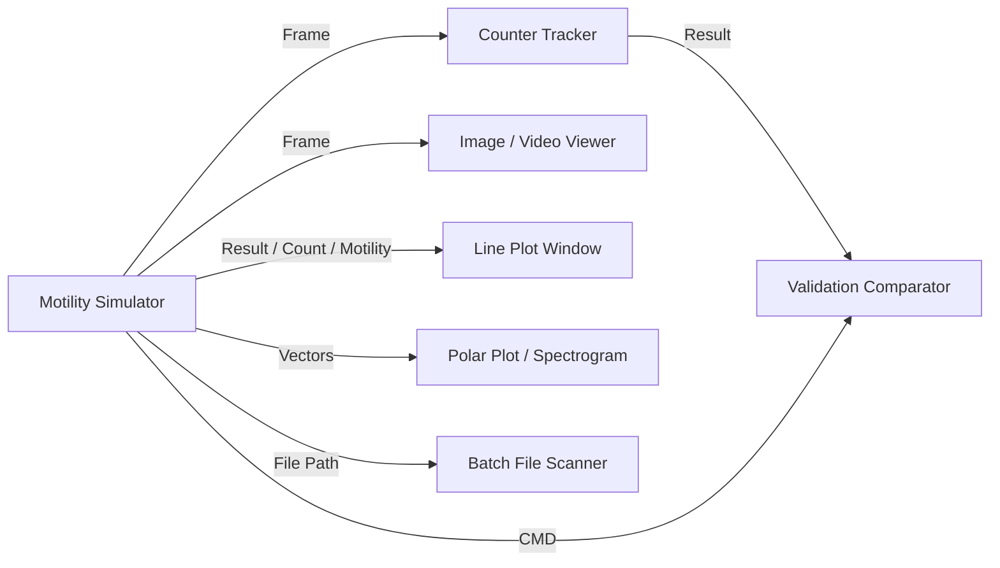

# Motility Simulator Module (`motility_simulator_win.py`)

## Description
The **Motility Simulator** generates synthetic microscopy video streams and datasets with 100% known ground truth physics. It is engineered to benchmark, calibrate, and validate computer vision tracking algorithms (e.g., the Motilitometer Counter Tracker: contour extraction, object tracking, dense optical flow, and drift correction).

The module features a vectorised 2D physics engine, multi-layer sprite rendering, phototaxis kinematics, hydrodynamic fluid drift, camera out-of-focus blur, interactive joystick-controlled directional vectors, and complete ground-truth telemetry export (`*_gt.csv` and `*_params.json`).

---

## Inputs / Outputs

### Inputs
- **`IOTypes.CMD_DICT`**: Automation command dictionary to programmatically control simulation runs:
  - `start`, `stop`, `pause`, `reset`, `photoshock`, `export`: Boolean action flags.
  - `preset`: Path or preset filename to load on the fly (e.g., `"Standard_Chlamydomonas.json"`).
  - Any configuration parameter key (`"density"`, `"speed_mean"`, `"photo_on"`, etc.) with its target value.
- **`IOTypes.FRAME`**: Live external video frame for the background overlay / blend view modes (`"Blend (Overlay)"`, `"Input Frame"`, `"Simulation"`).
- **`IOTypes.TRIGGER`**: Control trigger pulses (`"START"`, `"STOP"`, `"RESET"`).

### Outputs
- **`Frame`** (`IOTypes.FRAME`): Output BGR video frame (`(np.ndarray, "synthetic", frame_idx)`), compatible with `Image_viewer_win`, `Video_viewer_win`, or the `Counter_tracker_win`.
- **`CMD`** (`IOTypes.CMD_DICT`): Real-time telemetry dictionary containing ground-truth kinematics, population statistics, and simulation time stamps.
- **`Tracking`** (`IOTypes.TRACKING`): Ground-truth centroid positions, unique persistent organism IDs, and active trajectory history.
- **`Contours`** (`IOTypes.CONTOURS`): Synthetic boundary contour coordinates for each simulated organism.
- **`Result`** (`IOTypes.SAMPLE`): Instantaneous ground-truth composite metrics (surface coverage % or mean speed).
- **`Count`** (`IOTypes.SAMPLE`): Actual number of active organisms within the simulated field of view.
- **`Motility`** (`IOTypes.SAMPLE`): Ground-truth motility percentage of the population.
- **`Raw Speeds`** (`IOTypes.SAMPLE`): Array of instantaneous organism speeds.
- **`Vectors`** (`IOTypes.VECTORS`): Ground-truth velocity vector field.
- **`Trigger`** (`IOTypes.TRIGGER`): Impulses emitted at simulation run `"START"` and `"STOP"`.
- **`File Path`** (`IOTypes.FILE_PATH`): Exported video file path `(video_path, basename)` following offline rendering, feeding downstream batch pipelines.

---

## Parameters and Configuration (Persistent Fields)

### General & Export Parameters

| Parameter | Type | Default Value | Description |
| :--- | :--- | :--- | :--- |
| **`label`** | `str` | `"Motility Simulator"` | Title displayed in the window header. |
| **`export_dir`** | `str` | `"~/MotilitySimulator"` | Destination folder for exported videos, ground-truth CSVs, and parameter JSONs. |
| **`export_name`** | `str` | `"synthetic"` | Base filename prefix for export artifacts. |
| **`export_format`** | `str` | `"AVI lossless (FFV1)"` | Video encoder container (`"AVI lossless (FFV1)"`, `"AVI MJPG"`, `"MP4 (mp4v)"`). |
| **`update_with_input`**| `bool` | `True` | Update simulation resolution, FPS, and calibration automatically when receiving an external video frame. |
| **`overlay_view_mode`**| `str` | `"Blend (Overlay)"` | Video compositing mode (`"Blend (Overlay)"`, `"Input Frame"`, `"Simulation"`). |
| **`x_axis_mode`** | `str` | `"Fixed ΔT"` | Temporal stamping mode for sample series (`"Fixed ΔT"`, `"Timestamp"`, `"Index"`). |
| **`delta_t`** | `float` | `0.0333` | Time increment $\Delta t$ per frame in seconds ($1 / \text{fps}$). |

### Simulation Physics & Appearance (Core `PARAMS`)

| Parameter | Kind | Default Value | Description |
| :--- | :--- | :--- | :--- |
| **`width`** | `int` | `800` | Frame width in pixels. |
| **`height`** | `int` | `600` | Frame height in pixels. |
| **`fps`** | `float` | `30.0` | Simulation and video acquisition frame rate (frames per second). |
| **`calibration`** | `float` | `0.7575` | Scale factor ($\mu m/\text{pixel}$). Must match Tracker calibration for physical speed validation. |
| **`duration_s`** | `float` | `0.0` | Run duration in seconds ($0.0 = \text{unlimited live run}$; default export uses $10\text{ s}$). |
| **`bg_mode`** | `combo` | `"Solid color"` | Background mode (`"Solid color"`, `"Image (stretched)"`, `"Live frame (overlay)"`). |
| **`bg_color`** | `color` | `(20, 20, 25)` | Background RGB fill color when in solid color mode. |
| **`bg_noise`** | `float` | `0.0` | Additive sensor noise standard deviation on background pixels. |
| **`sprite_mode`** | `combo` | `"Circle"` | Organism rendering style (`"Circle"`, `"PNG image"`, `"Ring (outline)"`). |
| **`radius_mean`** | `float` | `5.0` | Mean organism radius in pixels. |
| **`radius_std`** | `float` | `0.5` | Standard deviation of organism radius. |
| **`count`** | `int` | `100` | Number of simultaneous organisms in the simulation. |
| **`motile_pct`** | `float` | `90.0` | Percentage of active swimming organisms vs. immotile individuals. |
| **`speed_mean`** | `float` | `80.0` | Mean swimming speed in $\mu m/s$. |
| **`speed_std`** | `float` | `15.0` | Standard deviation of swimming speed in $\mu m/s$. |
| **`photo_on`** | `bool` | `False` | Enable directional phototaxis stimulation. |
| **`photo_angle`** | `float` | `90.0` | Phototaxis light source direction (0° = Right, 90° = Up, 180° = Left, 270° = Down). |
| **`photo_strength`**| `float` | `0.5` | Directional bias pull towards the light source ($0.0 = \text{random}$, $1.0 = \text{strict alignment}$). |
| **`drift_on`** | `bool` | `False` | Enable global hydrodynamic fluid drift. |
| **`drift_angle`** | `float` | `270.0` | Hydrodynamic drift flow angle (degrees). |
| **`drift_speed`** | `float` | `10.0` | Hydrodynamic drift velocity magnitude in $\mu m/s$. |
| **`helical`** | `bool` | `False` | Enable 3D helical swimming trajectory projection. |
| **`oof_pct`** | `float` | `15.0` | Percentage of organisms drifting out of the focal plane (defocus blur). |

---

## Key Features

- **Interactive Directional Joysticks**: Directional angles (`intention_angle`, `photo_angle`, `drift_angle`) feature an intuitive joystick button adjacent to their numeric inputs. Clicking and dragging the mouse continuously reorients the angle vector in real time.
- **Live Ground Truth Telemetry**: Displays exact ground truth metrics in the header (`Count: N | Motility: % | Mean Speed: µm/s`), enabling immediate side-by-side comparison with downstream tracker estimations.
- **Preset Management**: Built-in Presets menu with one-click presets (`Standard_Chlamydomonas.json`, `Phototaxis.json`, `Helical_Swimmers.json`, etc.), configuration export, and file loading. Loading a preset during a live run immediately updates the active simulation.
- **Full Ground-Truth Export**: Generates `<name>.avi|mp4` alongside a detailed `<name>_gt.csv` file (recording organism id, frame number, x/y pixel and $\mu m$ coordinates, velocity vectors, speed, heading, motility state, adhesion, and focal depth) and a `<name>_params.json` descriptor.
- **Real-Time Frame Compositing**: Accepts input frames from physical cameras or video files to blend synthetic swimmers directly onto real experimental backgrounds.

---

## Pipeline Integration Example

