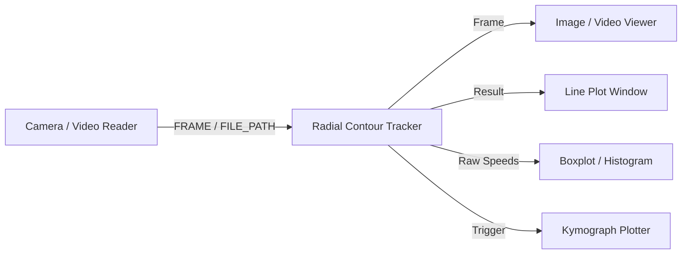

# Radial Contour Tracker Module (`radial_contour_tracker_win.py`)

## Description
The **Radial Contour Tracker** is a specialized spatial tracking and chemotaxis analysis engine within the Motilitometer suite. It is designed specifically for assays measuring organism migration toward or away from a localized chemical attractant, repellent pellet, or center of interest.

The module computes the radial distance from every segmented organism to the defined attractant pellet center, projects concentric distance reticules onto the live stream, constructs real-time proximity density heatmaps, and outputs granular spatio-temporal detection logs (`*_radial_detections.csv`) for downstream analysis in the `Kymograph Plotter`.

---

## Inputs / Outputs

### Inputs
- **`IOTypes.FRAME`**: Live incoming video frames from industrial cameras (`SeeCam`, `Hamamatsu`, `Alvium`, `Webcam`) or video playback modules (`Video Reader`).
- **`IOTypes.TRIGGER`**: Synchronization signals:
  - `"START"` or `"RESET"`: Clears sample history, resets tracking IDs, and initiates a clean recording run.
  - `"STOP"`: Finalizes active recording buffers.
- **`IOTypes.FILE_PATH`**: Video path passed to trigger automatic multi-core chunked batch analysis.

### Outputs
- **`Frame`** (`IOTypes.FRAME`): Annotated visualization frame featuring circular/rectangular crop outlines, pellet reticules, bounding boxes, centroid identifiers, and distance trails.
- **`Tracking`** (`IOTypes.TRACKING`): Dictionary of persistent organism trajectories and spatial positions.
- **`Contours`** (`IOTypes.CONTOURS`): List of segmented object contour point coordinates.
- **`Result`** (`IOTypes.SAMPLE`): Real-time distance time-series (or optical flow velocity) per organism emitted to `Lineplot_win`.
- **`Raw Speeds`** (`IOTypes.SAMPLE`): Speed distribution samples formatted for `Histogram_win` and `Boxplot_win`.
- **`Trigger`** (`IOTypes.TRIGGER`): Completion impulse carrying the output video or CSV path for batch orchestration (`File Scanner Emitter`).

---

## Parameters and Configuration (Persistent Fields)

| Parameter | Type | Default Value | Description |
| :--- | :--- | :--- | :--- |
| **`label`** | `str` | `"Radial Contour Tracker"` | Window title bar name. |
| **`x_axis_mode`** | `str` | `"Fixed ΔT"` | Time stamping mode (`"Fixed ΔT"`, `"Timestamp"`, `"Index"`). |
| **`delta_t`** | `float` | `0.0333` | Frame time increment $\Delta t$ in seconds ($1 / \text{fps}$). |
| **`auto_export_csv`** | `bool` | `True` | Automatically save `*_radial_detections.csv` and summary files at end of run. |
| **`reprocess`** | `bool` | `False` | Reload parameters from previously created `.processed` metadata files. |
| **`static_speed_thresh`** | `float` | `0.5` | Speed cutoff ($\mu m/s$) differentiating static and moving organisms. |
| **`kymograph_bin_width`** | `int` | `20` | Spatial radial bin width (pixels or $\mu m$). |
| **`kymograph_num_bins`** | `int` | `10` | Total number of concentric radial classification bins. |
| **`spatial_scale`** | `float` | `1.0` | Spatial calibration factor ($\text{unit}/\text{pixel}$). |
| **`spatial_unit`** | `str` | `"µm"` | Physical unit of length (`"µm"`, `"mm"`, `"px"`). |
| **`adjustment_mode`** | `bool` | `False` | Tuning mode: disables CSV exports and memory accumulation during setup. |
| **`invert_image`** | `bool` | `False` | Invert image grayscale intensity (brightfield vs. darkfield). |
| **`crop_type`** | `str` | `"Circular"` | Boundary mask type (`"None"`, `"Circular"`, `"Rectangle"`). |
| **`crop_radius`** | `int` | `150` | Circular field-of-view mask radius in pixels. |
| **`crop_width`** | `int` | `300` | Rectangular mask width in pixels. |
| **`crop_height`** | `int` | `300` | Rectangular mask height in pixels. |
| **`show_crop_outline`** | `bool` | `True` | Render green boundary outline on the output image frame. |
| **`crop_use_abs_center`**| `bool` | `False` | Use fixed absolute coordinates $(X, Y)$ for the crop center instead of relative offsets. |
| **`crop_center_x`** | `int` | `0` | Absolute X coordinate of the crop center. |
| **`crop_center_y`** | `int` | `0` | Absolute Y coordinate of the crop center. |
| **`crop_offset_x`** | `int` | `0` | Relative horizontal offset from the image frame center. |
| **`crop_offset_y`** | `int` | `0` | Relative vertical offset from the image frame center. |
| **`pellet_use_abs_center`**| `bool` | `False` | Use fixed absolute coordinates $(X, Y)$ for the attractant pellet center. |
| **`pellet_center_x`** | `int` | `0` | Absolute X coordinate of the attractant pellet. |
| **`pellet_center_y`** | `int` | `0` | Absolute Y coordinate of the attractant pellet. |
| **`pellet_offset_x`** | `int` | `0` | Relative horizontal offset of the pellet from frame center. |
| **`pellet_offset_y`** | `int` | `0` | Relative vertical offset of the pellet from frame center. |
| **`pellet_radius`** | `int` | `15` | Radius of the attractant pellet exclusion zone in pixels. |

---

## Key Features

- **Decoupled Geometric Centers**: Separates the plate/well boundary crop center from the attractant pellet location, accommodating non-centered stimulus deposits.
- **Radial Distance & Distance Reticules**: Continuously projects concentric reference rings centered on the pellet to visually gauge organism migration distance.
- **Proximity Density Heatmaps**: Renders real-time colormapped density overlays (`Inferno`, `Jet`, `Turbo`, `Viridis`, `Plasma`) illustrating local accumulation zones.
- **Multi-Core Chunked Batch Processing**: Automatically parallelizes heavy multi-gigabyte video files across multiple CPU workers, exporting frame-by-frame coordinate traces into `*_radial_detections.csv`.
- **Direct Compatibility with Kymograph Plotter**: Output CSV format is tailored directly for immediate import into the `Kymograph Plotter` module for 2D/3D spatio-temporal heatmap generation.

---

## Pipeline Integration Example

