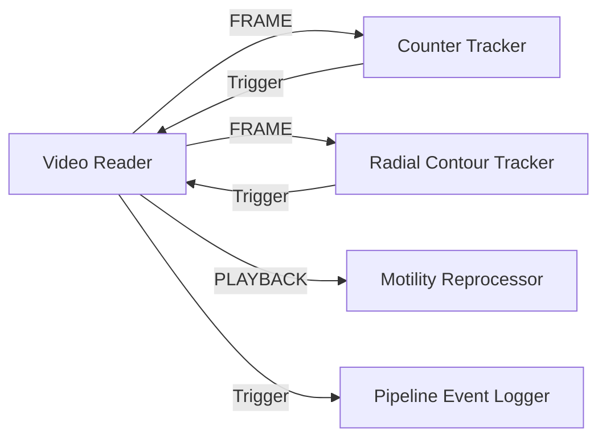

# Video Reader Module (`video_reader_win.py`)

## Description
The **Motilitometer Video Reader** provides hierarchical directory scanning, interactive video navigation with tree views, automated batch queue processing with visual status color-coding, and frame-accurate video streaming for the Motilitometer computer vision analysis pipeline.

It serves as the primary data ingress node, streaming frames to downstream trackers (`Counter Tracker`, `Radial Contour Tracker`, `Motility Reprocessor`), emitting completion triggers, feeding batch file paths, and transmitting synchronized frame-level telemetry (`IOTypes.PLAYBACK`).

---

## Inputs / Outputs

### Inputs
- **`IOTypes.FOLDER_PATH`**: Directory path string or tuple to set active working folder and generate the file tree.
- **`IOTypes.FILE_PATH`**: Direct path to a video file. Automatically loads its parent directory and selects the video.
- **`IOTypes.TRIGGER`**: Downstream completion notification. When batch processing is active (`Process ALL`), receiving a trigger automatically advances the queue to the next video.
- **`IOTypes.CMD_DICT`**: Command dictionary supporting remote automation:
  - `{"start": True}`: Begins video playback.
  - `{"stop": True}`: Stops video playback.
  - `{"pause": True}`: Toggles playback pause.
  - `{"browse": True}`: Opens directory picker.
  - `{"fps": int}`: Sets target playback frame rate.
  - `{"folder": str}`: Sets active root folder.

### Outputs
- **`Frame`** (`IOTypes.FRAME`): Emits a tuple `(frame, video_name, frame_idx)` containing the decoded OpenCV BGR image array, video basename, and 0-indexed frame number.
- **`Trigger`** (`IOTypes.TRIGGER`): Emits lifecycle event strings (`"START"` when playback begins, `"STOP"` when finished or stopped).
- **`File Path`** (`IOTypes.FILE_PATH`): Emits a tuple `(file_path, basename)` on queue advancement or manual context menu request.
- **`Playback`** (`IOTypes.PLAYBACK`): Real-time playback synchronization dictionary carrying `path`, `name`, `frame_idx`, `total_frames`, and `playing` status to synchronize `Motility Reprocessor`.

---

## Parameters and Configuration (Persistent Fields)

| Parameter | Type | Default Value | Description |
| :--- | :--- | :--- | :--- |
| **`label`** | `str` | `"Video Reader"` | Window title bar name. |
| **`folder`** | `str` | `""` | Currently selected working root folder path. |
| **`file_format`** | `str` | `"All"` | File format filter extension (`"All"`, `".mp4"`, `".mov"`, `".avi"`, `".mkv"`, `".webm"`, `".m4v"`). |
| **`recursive`** | `bool` | `True` | Recursively scan subfolders to discover nested video files. |
| **`reprocess`** | `bool` | `True` | When unchecked, skips videos that already have a `.processed` metadata file alongside them. |

---

## Key Features

- **Hierarchical Directory Tree**: Scans root directories and nested subdirectories recursively, rendering an interactive tree view with DearPyGui tree nodes.
- **Automated Batch Processing Queue (`Process ALL`)**:
  - Sequentially dispatches discovered videos to downstream trackers.
  - Automatically advances to the next video upon receiving downstream completion triggers (`IOTypes.TRIGGER`).
  - **Reprocess Toggle**: Option to skip already analyzed files (tracked via `.processed` flag files) or force complete re-analysis.
  - **Subtree Execution**: Right-click context menu on any directory node to process only that specific directory subtree.
- **Visual Status Color-Coding**:
  - **Yellow / Amber**: Currently active video in playback or analysis.
  - **Green**: Completed / analyzed video file (detected `.processed` flag file).
- **Media Playback & Scrubber**:
  - Transport controls: Play, Pause, and Stop buttons backed by a multithreaded daemon worker.
  - Interactive timeline seek bar / scrubber with instant paused preview.
  - Adjustable frame rate (FPS) with frame-interval throttling.
- **Context Menu Dispatch**: Right-click on any video to manually transmit its file path downstream via the `File Path` output.

---

## Pipeline Integration Example

