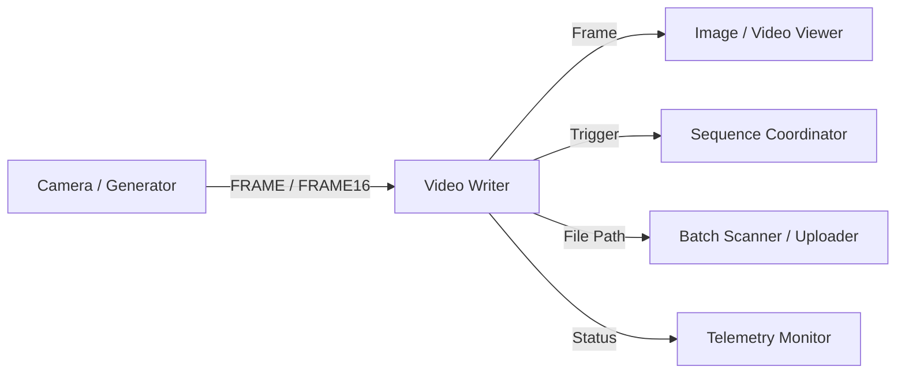

# Video Writer Module (`video_writer_win.py`)

## Description
The **Video Writer** module records incoming image and video streams into high-performance video files (`.mp4`, `.mkv`, `.avi`, `.mov`) with **smart real-time frame rate synchronization (Drop & Duplicate)**, multi-backend encoding (VidGear `WriteGear`, direct FFmpeg subprocess pipe, OpenCV fallback), and native support for standard and exotic image formats (Mono 8-bit, 12-bit / 16-bit Mono/HDR `uint16`, BGRA).

It features a non-blocking bounded ingestion queue ($< 0.05\text{ ms}$ per frame) and a dedicated background recording worker thread that isolates disk I/O and video compression from the DearPyGui render loop, ensuring zero UI freezes during continuous capture.

---

## Inputs / Outputs

### Inputs
- **`IOTypes.FRAME`**: Standard 8-bit image frame (single `np.ndarray` or `(frame, name)`).
- **`IOTypes.FRAME12`**: 12-bit HDR/Mono image frame (`uint16` array).
- **`IOTypes.FRAME16`**: 16-bit HDR/Mono image frame (`uint16` array).
- **`IOTypes.MASK`**: 8-bit binary or grayscale segmentation mask.
- **`IOTypes.FOLDER_PATH`**: Sets the output destination folder for recorded video files.
- **`IOTypes.FILE_PATH`**: Sets the output destination directory based on an input file path.
- **`IOTypes.TRIGGER`**: Trigger event signal.
- **`IOTypes.CMD_DICT`**: Command dictionary supporting remote automation:
  - `{"start": True}` / `{"record": True}`: Initiates recording.
  - `{"record": True, "duration": 30.0}`: Records for a specified duration in seconds and automatically stops.
  - `{"stop": True}`: Stops recording and finalizes output files.
  - `{"pause": True}`: Toggles recording pause/resume.
  - `{"fps": int}`: Configures target framerate.
  - `{"folder": str}`: Sets destination directory.
  - `{"prefix": str}`: Sets filename prefix.

### Outputs
- **`Frame`** (`IOTypes.FRAME`): **Pass-through**: Re-emits the input frame and metadata downstream without blocking or copying.
- **`File Path`** (`IOTypes.FILE_PATH`): Emits a tuple `(file_path, basename)` upon recording completion.
- **`Trigger`** (`IOTypes.TRIGGER`): Emits lifecycle event strings (`"RECORD_START"`, `"RECORD_PAUSE"`, `"RECORD_RESUME"`, `"RECORD_STOP"`, and `"READY"`).
- **`Status`** (`IOTypes.STATUS_DICT`): Emits live metrics dictionary (FPS, duration, frames written/dropped/duplicated, file size).

---

## Parameters and Configuration (Persistent Fields)

| Parameter | Type | Default Value | Description |
| :--- | :--- | :--- | :--- |
| **`label`** | `str` | `"Video Writer"` | Window header title. |
| **`target_fps`** | `int` | `30` | Output video target framerate (1 to 240 FPS). |
| **`codec`** | `str` | `"H.264 (libx264)"` | Video encoder backend (H.264, NVENC, QuickSync, H.265, MJPEG, ProRes, FFV1, OpenCV). |
| **`container`** | `str` | `".mp4"` | File container format (`".mp4"`, `".mkv"`, `".avi"`, `".mov"`). |
| **`preset`** | `str` | `"veryfast"` | FFmpeg compression speed/efficiency preset. |
| **`bitrate_mbps`** | `float` | `8.0` | Target compression bitrate in megabits per second (1.0 to 50.0 Mbps). |
| **`sync_mode`** | `str` | `"Realtime (Drop / Duplicate)"` | Synchronization mode (`"Realtime (Drop / Duplicate)"` or `"Pass-through (Sequential 1:1)"`). |
| **`bitdepth_mode`**| `str` | `"8-bit Tone-mapped"` | Bit-depth encoding mode (`"8-bit Tone-mapped"` or `"Native Full Bit-Depth"`). |
| **`output_dir`** | `str` | `""` | Output directory path where recorded video files are stored. |
| **`file_prefix`** | `str` | `"recording"` | Filename prefix (appended with timestamp `_YYYYMMDD_HHMMSS`). |

---

## Key Features

- **Smart Real-Time Synchronization (Drop / Duplicate)**:
  - Eliminates temporal distortion caused by mismatched hardware and recording frame rates.
  - When the source exceeds target FPS, excess frames per time-slot ($\Delta t = 1/\text{fps}$) are dropped to guarantee exact real-world duration.
  - When upstream processing delays frames, missing frames are duplicated to maintain $1:1$ temporal accuracy.
  - Pass-through mode is available for sequential offline rendering without dropping frames.
- **Asynchronous Bounded Queue Architecture**:
  - Employs a non-blocking bounded queue to isolate frame ingestion from disk compression.
  - Automatic oldest-frame eviction under extreme storage congestion prevents memory bloat.
- **Hardware-Accelerated Encoders**:
  - Supports GPU-accelerated encoding via **NVIDIA NVENC** (`h264_nvenc`, `hevc_nvenc`), **Intel QuickSync** (`h264_qsv`), and **AMD AMF**.
- **High Bit-Depth & HDR Support**:
  - Preserves 12-bit and 16-bit raw data using lossless codecs (FFV1, ProRes, HEVC Main10) or fast SIMD tone-mapping to standard 8-bit MP4.
- **Live Performance Telemetry**:
  - Collapsing header displaying live ingest FPS, output FPS, elapsed/real duration, frames written, dropped, duplicated, and current file size on disk.

---

## Pipeline Integration Example

